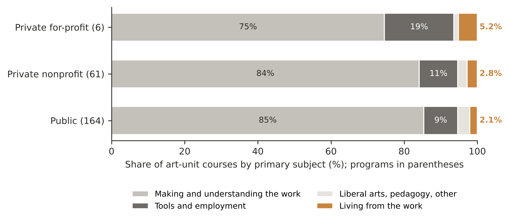
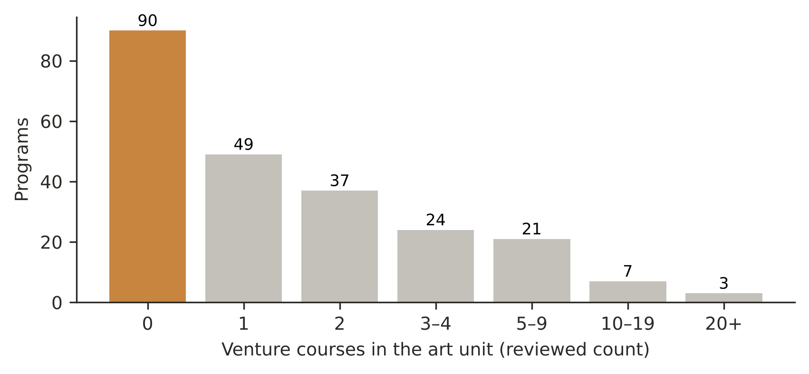
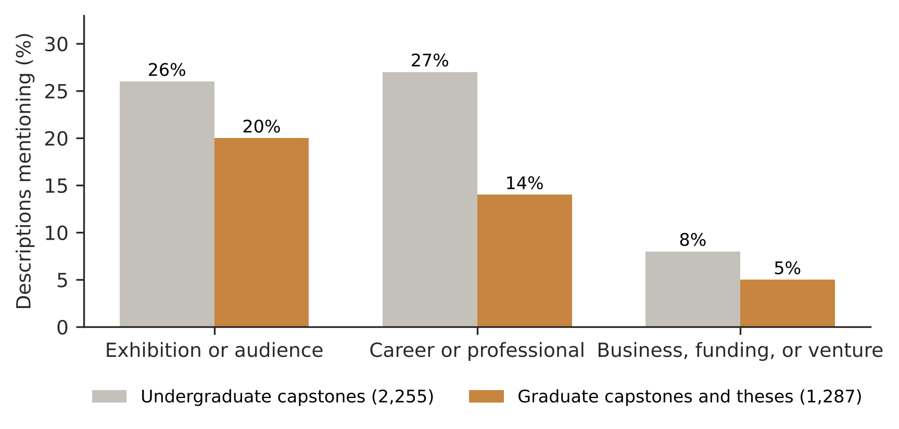

# Online Appendix — Making the Work, Not the Living: A Course-Level Census of Entrepreneurship Teaching in 231 American Art and Design Programs

*Accompanies Paper A v18.6. Data, code, rubric versions, boundary rulings, sealed samples, coder exports, and the pre-registration with its amendments are in the public deposit: https://doi.org/10.5281/zenodo.23573815 and https://github.com/brinkwar/bottega-index (pre-registration: https://github.com/brinkwar/bottega-index/tree/main/prereg_round2). Where this appendix refers to "the deposit," it means these two records. Coder exports are in the repository (`results_round1/` and `results_round2/`); the sealed samples, the batch-replication arms, and the venture census are in the Zenodo record under `validation/`.*

## A. Corpus and art unit

### A.1 Population and harvest

The population is every U.S. institution awarding at least 50 art and design degrees a year (IPEDS completions, CIP 50.01–.07 and 50.13; performing arts and arts administration excluded), together with every program on the U.S. News fine-arts list. Published course catalogs were harvested at 257 institutions between 9 and 21 September 2026: 1,141,920 catalog records, which merge to 993,796 distinct courses. At 247 of the 257 the harvested catalog covers every academic unit; at 10 it is the art unit's own catalog. Institutions that could not be harvested, and the reason for each, are listed in the deposit.

### A.2 Reporting floors

An institution is reported when at least 70% of its art-unit courses carry a description and its art unit holds at least 100 courses. 231 institutions meet both floors; their art units contain 73,558 courses. The other 26 are set aside and documented in the deposit. The campus-wide analysis uses the 221 reporting institutions whose catalog covers every unit (929,759 courses).

### A.3 The art unit

Within each institution, records describing the same course were merged, and the art unit was identified at the subject-prefix level from catalog subject names and prefix codes. Three published boards rule on boundaries no instruction could draw: architecture versus design, film and media, and a correction board for prefixes misassigned by the automated step. Every ruling is listed row by row in the deposit with the test applied. In round two, two independent coders agreed with each other on art-unit membership at κ = .94 and with the instrument's boundary at κ = .82 (80 prefixes).

## B. Classification

### B.1 Instrument

Every described art-unit course — 80,951 records at the 257 institutions — was classified, with no keyword pre-selection, by one pinned language model (Claude Sonnet 4.6, identifier claude-sonnet-4-6) at temperature 0 against a published, versioned rubric (v0.56 for this release; every version is in the deposit, with the prompt signature that identifies the exact instruction text). Each course is classified on five measures — technology, employment, venture, self, and audience — and, separately, into one of twelve composition categories by its primary subject. Venture and employment exclude each other. (The employment measure is the column labeled `practice` in the released data.) Courses were sent in synchronous requests of up to 20 courses from one institution; the prompt carries the first 900 characters of each description.

### B.2 Boards applied after classification

Two course-level rulings were made after classification and are published as boards rather than written into the instruction, because tested rewordings of the instruction did not draw them reliably (B.4). The *industry-role board* rules that training for a producer or other role in someone else's company is employment rather than venture (52 courses moved from venture to employment). The *self-critique board* rules that critique of students' work is not the study of the creative process: of the 274 courses the instrument marked self at the 257 institutions, 73 were removed and 201 kept after three independent coders had read all of them (199 of the 201 are at the 231 reporting institutions). The rationale for the self-critique ruling is in Section F.

### B.3 Outside the art unit

Outside the art unit, the whole-catalog index was searched with a published entrepreneurship lexicon and every match was classified by the same model. Outside-unit counts are therefore lower bounds: a course outside the art unit that the lexicon does not match is not read.

### B.4 Testing changes to the instruction

Any change to the instruction was tested against a fixed oracle before adoption: six rewordings of the venture definition against 158 hand-adjudicated courses, and two rewordings of the industry-role rule against a 163-row oracle. None improved on the original wording (the best-scoring venture rewording against the original: McNemar p = 1), and the original was kept. Both oracles, every candidate wording, and their scores are in the deposit's audit log. In round two, two independent coders agreed with each other on the oracle's rulings at κ = .81 but with the author's rulings at κ = .29 and .44; the oracle rulings are therefore reported as contested.

## C. Validation, round one

### C.1 Design

Three independent coders, blind to the instrument and to each other, coded a sealed stratified sample of 360 courses (357 with usable text), a 30-course calibration set, and every course the instrument marked self (274) or audience (313): 977 items each. A fourth coder was excluded under two answer-independent protocol criteria applied after the file arrived, which were not pre-registered (an unused cannot-tell flag; sub-three-second answers); that coder's answers are retained in the repository (`results_round1/`, in files named `*_R3_excluded.csv`) as a sensitivity row. Agreement is reported as Fleiss' κ and Krippendorff's α across coders, Cohen's κ for the human majority against the instrument, and the prevalence-adjusted bias-adjusted κ (PABAK; Byrt et al., 1993), because venture, self, and audience are rare.

**Table A1. Round-one agreement, main sample (357 courses with text; three coders; 1,000-resample bootstrap 95% CIs)**

| Measure | Fleiss' κ | Krippendorff's α | Majority vs instrument κ | PABAK | Instrument + / majority + |
|---|---|---|---|---|---|
| Technology | .85 (.77–.90) | .85 (.77–.91) | .82 (.72–.90) | .92 (.88–.96) | 54 / 45 |
| Employment | .72 (.60–.81) | .72 (.60–.81) | .72 (.59–.82) | .89 (.84–.93) | 47 / 33 |
| Venture | .85 (.79–.90) | .85 (.79–.90) | .78 (.68–.86) | .88 (.83–.93) | 46 / 65 |
| Self | .76 (.65–.85) | .76 (.66–.85) | .86 (.75–.94) | .95 (.92–.98) | 36 / 33 |
| Audience | .54 (.45–.64) | .54 (.45–.62) | .75 (.65–.85) | .88 (.84–.93) | 41 / 56 |

### C.2 Reading the results

Agreement between independent coders is high on venture and technology (α = .85, above Krippendorff's .80 threshold for relying on data; Krippendorff, 2019), adequate on self and employment (.76 and .72, in the band that supports tentative conclusions), and low on audience (.54), the least settled measure in the paper. The audience disagreements have one dominant source: 38 of the 66 courses on which coders split also drew a venture mark, the question being whether marketing inside an entrepreneurship course is also audience-building. On venture the coders marked more courses than the instrument (65 against 46), the first sign of the instrument's conservatism that round two measured directly. On self and audience the instrument agrees with the human majority (κ .86 and .75) at least as well as the coders agree with each other; because a majority of three is more stable than a single coder, that comparison favors the instrument and is reported for completeness only.

Precision — the share of instrument positives the human majority confirms — is .79 for technology (42 of 53) and .70 for employment (23 of 33) on the random sample of instrument positives. Of the 313 audience courses, coders confirmed 93.6%; of the 274 self courses, 71.5% before the self-critique board and 88.8% outside critique seminars.

## D. Validation, round two (pre-registered)

### D.1 Registration

Before any coding, the sampling plan, estimates, reference rule, and decision rules were committed to the public repository (commit 321bcb3). Four amendments followed, each committed before the coding it governed: Amendment 1 (coder roster), Amendment 2 (replacement of a coder excluded at the paid calibration stage), Amendment 4 (single-coder reading of the venture pool — the pool reading), and Amendment 4a (the exact pool and draw log). An Amendment 3 was drafted and withdrawn before being committed; its number was not reused. The reference rule: a course is positive only when both coders mark it; no author adjudication enters any estimate.

### D.2 Samples

Two coders (one returning from round one, one new) coded, under the final codebook: all 357 named venture courses; 450 courses the instrument marked on no measure — 250 from pools where misses concentrate (courses a second, more liberal model, Claude Haiku 4.5, had marked) and 200 at random from the rest; 150 random courses for the composition categories; 100 random outside-unit venture courses; 80 subject prefixes; 58 oracle rows; 59 rows of the industry-role board; and 30 round-one courses for test–retest.

### D.3 Results (pre-registered analysis, run once)

**Table A2. Round-two agreement between the two coders (Cohen's κ)**

| Measure | All items coded on the measure | Miss sample (450 courses) |
|---|---|---|
| Venture | .88 | .74 |
| Technology | .51 | .38 |
| Self | .78 | .77 |
| Employment | .77 | .81 |
| Audience | .71 | .65 |

Venture precision: 326 of 357 confirmed by both coders (.913; Wilson 95% CI .879–.938). Estimated missed catalog records among courses the instrument marked on no measure (Horvitz–Thompson estimator; Horvitz & Thompson, 1952): technology ≈1,990 (848–3,314); employment ≈1,878 (1,066–2,880); venture ≈1,099 (233–2,232); self ≈117 (50–201); audience ≈110 (56–174). Composition: the coders agreed with each other at κ = .81 (.74–.88); the instrument agreed with each coder at κ = .55–.56, and of the 129 courses on which the two coders chose the same category, it placed 95 in the same of three groups (making and understanding the work; tools and employment; living from the work). Outside-unit sample: 92 of 100 confirmed as entrepreneurship by both coders; of these, both agreed on orientation for 86 (52 general business, 34 arts or creative enterprise) and on restriction for 90 (at least 25 stated a restriction; 6 stated the course was open to non-majors; 59 said nothing). Industry-role board: coders agreed with each other at κ = .72, with the author's rulings at κ = .08 and .15. Test–retest (returning coder): .93–1.00 by measure. Two pre-registered decision rules were triggered: venture counts are stated as lower bounds, and the oracle and industry-role rulings are described as contested.

### D.4 Corrected estimates (not pre-registered)

Estimated missed records were converted to courses at the ratio of distinct courses to catalog records among the classified art-unit records: the 80,951 described art-unit records at the 257 institutions merge to 73,652 described courses (ratio 0.91). For reference, the art units of the 257 hold 76,305 courses in all, described or not, and those of the 231 reporting institutions hold 73,558 — the denominator used throughout the paper. The converted misses were added to the named counts. Technology, employment, and venture were also adjusted for measured precision (C.2; D.3); audience and self were not. Intervals combine the bounds of the two components.

### D.5 The pool reading (pre-registered by Amendments 4 and 4a; reported separately from the originally registered estimates)

One coder read every remaining course (244) in the pool where Claude Haiku 4.5 had marked venture and the instrument had marked nothing, shuffled with 50 ordinary courses as decoys. Calibration: in round two, the second coder confirmed 31 of this coder's 36 venture marks in the same pool (.86). Results, computed once as pre-specified: 148 of 244 marked venture (60.7%; exact 95% CI 54.2–66.8%); 0 of 50 decoys marked venture (upper bound 7.1%); calibrated count 127 (104–141). The 148 courses sit at 68 institutions; 21 institutions move from zero to at least one venture course, so reporting programs with none fall from 111 to 90 of 231; because some misses remain, 90 is an upper bound on absence. The total for this pool (31 sampled plus 127 calibrated, ≈158) agrees with the round-two estimate for it (≈164). The confirmed courses are published in the deposit as the venture census board (the file keeps that name).

## E. Stability of the instrument and processing

### E.1 Batch context

Verdicts are cached against a hash of the full rendered prompt, so re-running an identical request reproduces its answer; the same course sent in a different batch is a different request. Re-running identical batches at temperature 0 on another day agreed on 99.0% of whole verdicts. Sending the same courses in batches of different composition agreed on 88.3–88.8%, and reversing their order within an identical batch changed about 10%. In the production run, 13,527 course texts were classified more than once (as parts of different batches); the copies disagree on 343 (2.5%), and the index uses the most recent. Batch context is therefore the largest source of run-to-run instability in the instrument; it is one reason the paper reports human-corrected estimates beside named counts.

### E.2 Truncation and retries

The prompt carries the first 900 characters of each description; 7,978 of 80,951 descriptions (9.9%) were cut. Sixteen production batches failed to parse and were retried course by course; at most 320 verdicts could have been recorded as marking no measure by that route.

## F. Rationale for the self-critique ruling

Following Shulman (2005), scholars of art and design education identify the critique, or crit, as the field's signature pedagogy (Klebesadel & Kornetsky, 2009; Motley, 2017; Orr & Shreeve, 2018), and describe it as a site of judgment and feedback on finished or in-progress student work (Blair, 2006; Orr & Bloxham, 2013). The accreditor of U.S. art and design programs lists critique among the components of studio work and states that students must "participate in critiques and discussions of their work and the work of others" (National Association of Schools of Art and Design [NASAD], 2015, Common Body of Knowledge and Skills, §VIII.B). The study of the creative process is a different object: an established field of research with its own models and definitions (Amabile, 1983; Runco & Jaeger, 2012), taught as a subject in U.S. higher education since at least 1967, when a creativity center was founded at Buffalo State (SUNY Buffalo State, n.d.), with meta-analytic evidence that creativity training produces moderate gains (Haase et al., 2025; Scott et al., 2004), though the largest review cautions that publication bias may inflate them (Sio & Lortie-Forgues, 2024). A crit about a student's painting is about the painting; a course whose subject is how ideas form and how a creative life is sustained is about the creative process.

## G. Search for comparative studies of delivery models

**Criterion.** A study counts if it compares discipline-embedded with business-school entrepreneurship teaching for arts students on any outcome (learning, intentions, self-efficacy, self-employment, income, venture formation, or validated preparedness).

**Table G1. Searches run on 12 November 2026**

| Source | Search | Hits | Screened | Meeting criterion |
|---|---|---|---|---|
| OpenAlex | "arts entrepreneurship" in title or abstract, 2000–2026 | 267 | Titles of first 100 | 0 |
| OpenAlex | "arts entrepreneurship" with "education outcome" (full text), 2000–2026 | 595 | Titles of top 50 by relevance | 0 |
| OpenAlex | (magnet OR radiant) AND (university-wide OR cross-campus) AND entrepreneurship, 2000–2026 | 85 | 85 titles | 0 |
| OpenAlex | *Artivate* (all issues), "arts entrepreneurship" | 116 | Titles | 0 |
| Web search | *Artivate* site search: entrepreneurship education, comparison, business school | — | 9 | 0 |
| Web search | ERIC-indexed records: "arts entrepreneurship" education outcomes | — | 9 | 0 |
| Web search | Named-candidate searches (arts or music entrepreneurship teaching in arts units versus business schools) | — | About 18 results; 9 candidates examined | 0 |

*Note.* Full Boolean versions of the search strings could not be run in OpenAlex, which ignored the operators; ERIC's interface and Google Scholar could not be queried automatically; and source-filtered searches of the *Journal of Arts Management, Law, and Society*, *Entrepreneurship Education and Pedagogy*, *Arts and Humanities in Higher Education*, and the *International Journal of Music Education* were not completed. The search is therefore targeted rather than exhaustive, and the paper's claim is limited to these searches.

**Candidates examined and excluded.** Beckman and Cherwitz (2009), conceptual chapter on curriculum design; Barber et al. (2026), one interdisciplinary program compared across students' colleges, not across delivery models; Duval-Couetil et al. (2016), compares program models but for engineering students; Welsh et al. (2014), program inventory and pilot survey; Thom (2015), comparison of curricula and extracurricular offerings, no outcomes; Thom (2017), survey of 210 fine-art lecturers; Pollard and Wilson (2014), four educator interviews; Guo and McGraw (2023), skills and careers from SNAAP data without coding where teaching was delivered; Streeter and Jaquette (2004), program typology without student outcomes.

**Result.** In these searches, no study met the criterion.

## H. Exploratory patterns in the corpus

**What this section is.** The main paper reports measures that were validated against independent human coders. This section reports something different: patterns found by matching keywords in the titles of the 73,568 art-unit courses that received a composition label at the 231 reporting programs. The keyword rules are case-insensitive regular expressions, published in the deposit. The rules were written to avoid the commonest false matches (for example, "video" in "video game," or "environment" in game and spatial design), but others will remain. A title can match more than one subject, a match records only that a title names a subject, and none of these counts has been checked by coders. The patterns are offered as leads for future research, not as findings.

### H.1 What art units teach, by subject

**Table H1. Course titles naming each subject, 231 programs**

| Subject | Courses | Share of titles (%) | Programs (of 231) |
|---|---|---|---|
| Film and video | 6,200 | 8.4 | 215 |
| Photography | 2,908 | 4.0 | 224 |
| Graphic and communication design | 2,083 | 2.8 | 216 |
| Drawing | 2,020 | 2.7 | 229 |
| Painting | 1,843 | 2.5 | 224 |
| Animation | 1,835 | 2.5 | 194 |
| Sculpture | 1,487 | 2.0 | 219 |
| Ceramics | 1,050 | 1.4 | 176 |
| Printmaking | 1,351 | 1.8 | 203 |
| Fashion | 1,571 | 2.1 | 95 |
| Game design and interactive media | 1,683 | 2.3 | 185 |
| UX, UI, and interaction design | 604 | 0.8 | 157 |
| Virtual, augmented, and immersive media | 248 | 0.3 | 88 |
| Artificial intelligence, machine learning, generative tools | 277 | 0.4 | 89 |
| 3-D printing and digital fabrication | 164 | 0.2 | 87 |
| Sustainability and ecology | 404 | 0.5 | 123 |
| Social practice and community art | 228 | 0.3 | 94 |
| Accessibility and disability | 63 | 0.1 | 37 |

*Note.* Keyword counts on course titles; a course can count under more than one subject.

Three patterns stand out (Figure H1). First, film and video is the largest medium by course title (8.4% of titles), ahead of photography (4.0%), graphic and communication design (2.8%), drawing (2.7%), and painting (2.5%), which is level with animation (2.5%). Second, newer subjects have already spread widely: game design and interactive media appear in 185 programs, more than ceramics (176); courses on artificial intelligence, machine learning, or generative tools appear in 89 programs (277 courses), and courses on virtual, augmented, or immersive media in 88. Third, some subjects are scarce relative to their importance for fields that design what people use: accessibility and disability appear in course titles at only 37 programs (63 courses), against 123 programs for sustainability and ecology and 94 for social practice and community art.

**Figure H1**

*Programs with at least one course title naming each subject*

{width=6.5in}

*Note.* Highlighted bars mark subjects discussed in the text.

### H.2 The curriculum by institutional sector

**Table H2. Composition of the art curriculum by institutional sector (% of art-unit courses by primary subject)**

| Sector (programs) | Making and understanding the work | Tools and employment | Liberal arts, pedagogy, other | Living from the work |
|---|---|---|---|---|
| Public (164) | 85.4 | 9.2 | 3.3 | 2.1 |
| Private nonprofit (61) | 84.1 | 10.6 | 2.6 | 2.8 |
| Private for-profit (6) | 74.6 | 18.9 | 1.3 | 5.2 |

*Note.* Composition pass, grouped as in Figure 4 of the main paper; sector from IPEDS.

The six for-profit institutions devote about 19% of their art-unit courses to tools and employment, against 9% to 11% elsewhere, and more than twice the share of public universities to living from the work; their curricula give the least weight to history and theory (Figure H2). Public universities give the largest share to pedagogy, consistent with their role in preparing art teachers. With six for-profit institutions, these contrasts are descriptive only.

**Figure H2**

*Composition of the art curriculum by institutional sector*

{width=6.5in}

### H.3 How venture teaching is distributed

On the reviewed count, 90 of the 231 programs offer no venture course in the art unit, 49 offer one, 37 offer two, and only 10 offer ten or more (Figure H3). The median program offers one.

**Figure H3**

*Programs by number of venture courses in the art unit*

{width=6.5in}

*Note.* Reviewed count (named courses plus those confirmed in the pool reading).

### H.4 What capstones and theses mention

Graduate capstone and thesis courses mention exhibition or audience, career or professional matters, and business or funding less often than undergraduate capstones do (Figure H4), although graduate students are closest to the working life the curriculum prepares them for.

**Figure H4**

*Capstone and thesis course descriptions mentioning professional content*

{width=6.5in}

*Note.* Keyword groups as described in the main paper's Implications; percentages of course descriptions.

### H.5 Uses for future research

The corpus is built to support four kinds of study. *Curriculum and outcomes:* each program carries its IPEDS identifier, so its catalog can be linked to College Scorecard earnings by field of study, to IPEDS completions, or, with SNAAP's restricted institution-level data, to its own alumni's reports — a first test of whether what a program teaches is associated with how its graduates fare. *Diffusion:* re-harvested each catalog year, the same rules can trace how subjects such as generative tools or immersive media spread through art education, and where they arrive first. *Whole-campus mapping:* because the index spans every unit of 221 universities (929,759 courses), any subject a catalog describes — ethics, sustainability, data science, or entrepreneurship in engineering or journalism — can be located across entire campuses. *Audits of coverage:* subjects that matter to a profession but are scarce in its curricula, such as accessibility in design, can be counted program by program. Each of these uses would need its own validation, as the five measures in the main paper received.

## References

All sources cited in this appendix:

Amabile, T. M. (1983). The social psychology of creativity: A componential conceptualization. *Journal of Personality and Social Psychology, 45*(2), 357–376. https://doi.org/10.1037/0022-3514.45.2.357

Barber, D., III, Yeager, E., Daughtry, T., Harris, M. L., & Paynter, S. (2026). Beyond one-size-fits-all: How academic discipline moderates entrepreneurship education effectiveness. *Small Business Institute Journal, 22*(2), 1–13. https://doi.org/10.53703/001c.161336

Beckman, G. D., & Cherwitz, R. A. (2009). Advancing the authentic: Intellectual entrepreneurship and the role of the business school in fine arts entrepreneurship curriculum design. In G. P. West III, E. J. Gatewood, & K. G. Shaver (Eds.), *Handbook of university-wide entrepreneurship education* (pp. 21–34). Edward Elgar.

Blair, B. (2006). At the end of a huge crit in the summer, it was "crap" – I'd worked really hard but all she said was "fine" and I was gutted. *Art, Design & Communication in Higher Education, 5*(2), 83–95. https://doi.org/10.1386/adch.5.2.83_1

Byrt, T., Bishop, J., & Carlin, J. B. (1993). Bias, prevalence and kappa. *Journal of Clinical Epidemiology, 46*(5), 423–429. https://doi.org/10.1016/0895-4356(93)90018-V

Duval-Couetil, N., Shartrand, A., & Reed, T. (2016). The role of entrepreneurship program models and experiential activities on engineering student outcomes. *Advances in Engineering Education, 5*(1). https://eric.ed.gov/?id=EJ1090582

Guo, W., & McGraw, D. J. (2023). The arts alumni have spoken: The impact of training in higher education on entrepreneurial careers. *Entrepreneurship Education and Pedagogy, 6*(3), 410–435. https://doi.org/10.1177/25151274221120071

Haase, J., Hanel, P. H. P., & Gronau, N. (2025). Creativity enhancement methods for adults: A meta-analysis. *Psychology of Aesthetics, Creativity, and the Arts, 19*(4), 708–736. https://doi.org/10.1037/aca0000557

Horvitz, D. G., & Thompson, D. J. (1952). A generalization of sampling without replacement from a finite universe. *Journal of the American Statistical Association, 47*(260), 663–685. https://doi.org/10.1080/01621459.1952.10483446

Klebesadel, H., & Kornetsky, L. (2009). Critique as signature pedagogy in the arts. In R. A. R. Gurung, N. L. Chick, & A. Haynie (Eds.), *Exploring signature pedagogies: Approaches to teaching disciplinary habits of mind* (pp. 99–117). Stylus.

Krippendorff, K. (2019). *Content analysis: An introduction to its methodology* (4th ed.). Sage.

Motley, P. (2017). Critique and process: Signature pedagogies in the graphic design classroom. *Arts and Humanities in Higher Education, 16*(3), 229–240. https://doi.org/10.1177/1474022216652765

National Association of Schools of Art and Design. (2015). *Competencies summary: The BFA in drawing.* https://nasad.arts-accredit.org/wp-content/uploads/sites/3/2015/11/BFA-Drawing.pdf

Orr, S., & Bloxham, S. (2013). Making judgements about students making work: Lecturers' assessment practices in art and design. *Arts and Humanities in Higher Education, 12*(2–3), 234–253. https://doi.org/10.1177/1474022212467605

Orr, S., & Shreeve, A. (2018). *Art and design pedagogy in higher education: Knowledge, values and ambiguity in the creative curriculum.* Routledge. https://doi.org/10.4324/9781315415130

Pollard, V., & Wilson, E. (2014). The "entrepreneurial mindset" in creative and performing arts higher education in Australia. *Artivate, 3*(1), 3–22. https://doi.org/10.1353/artv.2014.0009

Runco, M. A., & Jaeger, G. J. (2012). The standard definition of creativity. *Creativity Research Journal, 24*(1), 92–96. https://doi.org/10.1080/10400419.2012.650092

Scott, G., Leritz, L. E., & Mumford, M. D. (2004). The effectiveness of creativity training: A quantitative review. *Creativity Research Journal, 16*(4), 361–388. https://doi.org/10.1080/10400410409534549

Shulman, L. S. (2005). Signature pedagogies in the professions. *Daedalus, 134*(3), 52–59. https://doi.org/10.1162/0011526054622015

Sio, U. N., & Lortie-Forgues, H. (2024). The impact of creativity training on creative performance: A meta-analytic review and critical evaluation of 5 decades of creativity training studies. *Psychological Bulletin, 150*(5), 554–585. https://doi.org/10.1037/bul0000432

Streeter, D. H., & Jaquette, J. P., Jr. (2004). University-wide entrepreneurship education: Alternative models and current trends. *Southern Rural Sociology, 20*(2), 44–71. https://egrove.olemiss.edu/jrss/vol20/iss2/3

SUNY Buffalo State. (n.d.). *International Center for Studies in Creativity* [Graduate catalog]. Retrieved November 9, 2026, from https://ecatalog.buffalostate.edu/graduate/services-facilities/international-center-studies-creativity/

Thom, M. (2015). The suffering of arts entrepreneurs: Will fine art students be educated on how to become successfully self-employed? *Journal of Education and Training Studies, 3*(1), 64–77. https://redfame.com/journal/index.php/jets/article/download/587/548

Thom, M. (2017). Arts entrepreneurship education in the UK and Germany: An empirical survey among lecturers in fine art. *Education + Training, 59*(4), 406–426. https://doi.org/10.1108/ET-05-2016-0089

Welsh, D. H. B., Onishi, T., DeHoog, R. H., & Syed, S. (2014). Responding to the needs and challenges of arts entrepreneurs: An exploratory study of arts entrepreneurship in North Carolina higher education. *Artivate, 3*(2), 21–37. https://doi.org/10.1353/artv.2014.0006
