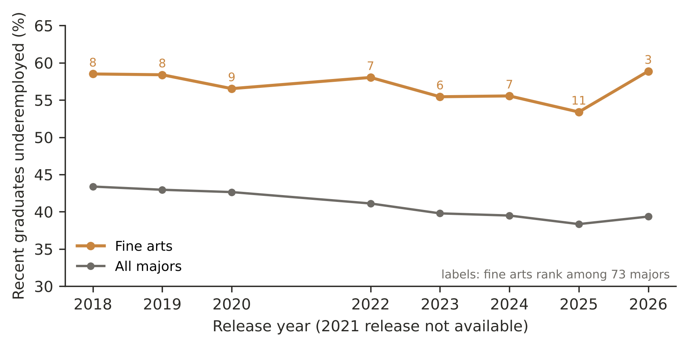
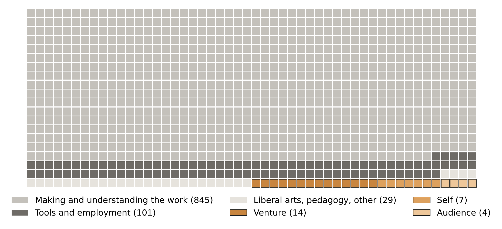
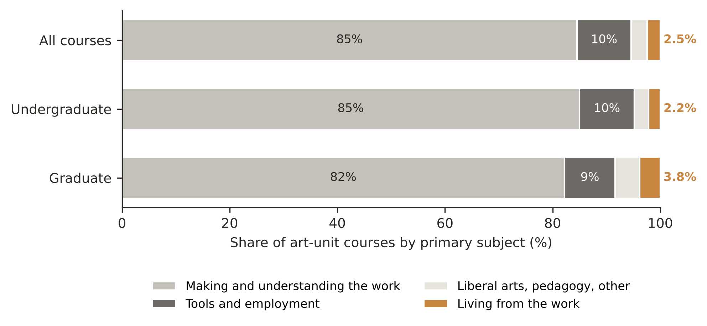
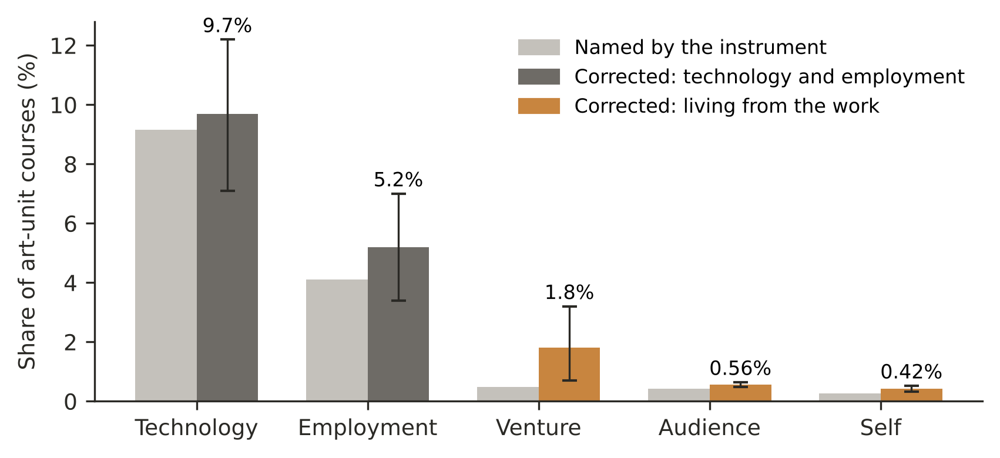
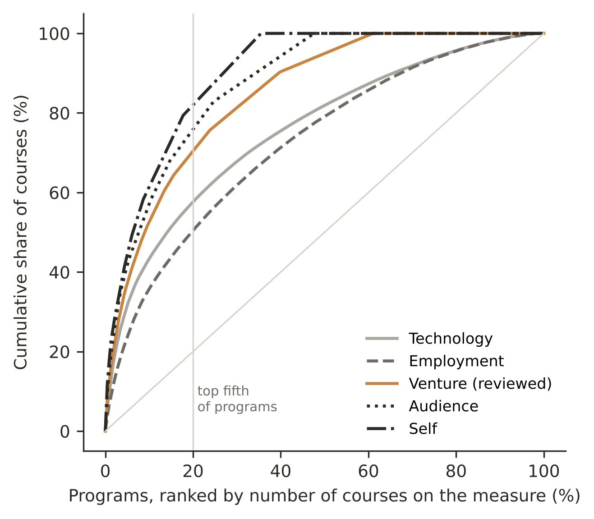
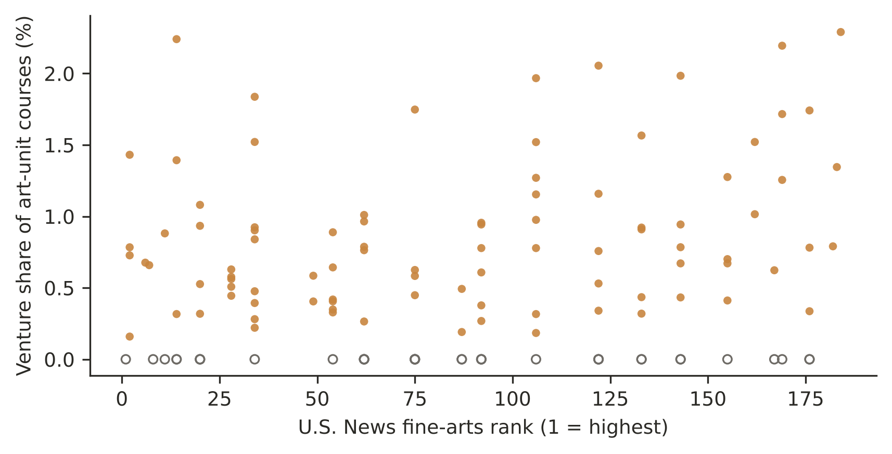
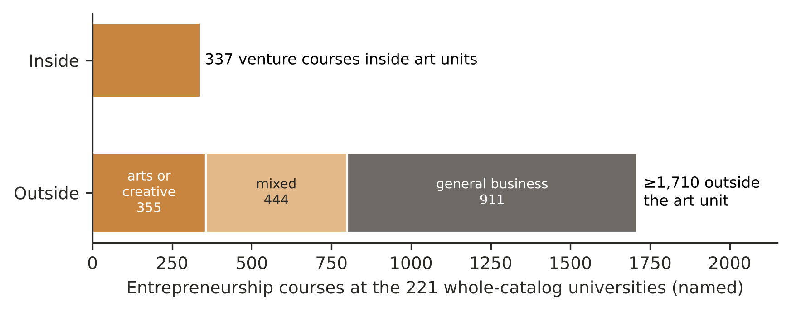

# Making the Work, Not the Living: A Course-Level Census of Entrepreneurship Teaching in 231 American Art and Design Programs

**Brinkley Warren** · Art Morph Institute, Hawaiʻi, USA · brink@artmorph.org · ORCID 0009-0009-6287-388X

*Preprint, 13 November 2026. Not yet peer reviewed. Data: https://doi.org/10.5281/zenodo.23573815 · Code: https://github.com/brinkwar/bottega-index*

---

## Abstract

Arts alumni have long named business and entrepreneurial skill as the widest gap in their education. We measure the curriculum's side: what art programs teach about living from the work (building an enterprise, reaching an audience, sustaining a creative life). We harvested the catalogs of 257 American institutions (993,796 courses) and classified every described course in the art units of 231 programs (which hold 73,558 courses) with a language model, validated in two rounds of independent human coding, the second pre-registered. Entrepreneurship is 0.49% of art-unit courses as the model names them, 0.66% once human coders added likely misses, and about 1.8% (95% interval 0.7–3.2) with all misses estimated, against about 10% for named software and tools. Up to 39% of programs offer no entrepreneurship course in their art department; a fifth of programs hold 70% of what exists; reputational rank does not predict the teaching. On most campuses the teaching sits in other units, mostly built for business students; counting partly arts-oriented courses, more than twice as many address arts enterprise outside the art unit as inside it. Opening existing courses to art students widens access soonest; we argue the destination is creative-enterprise teaching built inside art units.

**Keywords:** entrepreneurship education; arts entrepreneurship; curriculum; university-wide entrepreneurship; art and design; content analysis

---

## Introduction

The case for teaching artists to build working lives from their work was made early and well. Beckman (2007), visiting programs across the country, found arts entrepreneurship education already "adventuring" — more than a hundred courses nationally, private support in the hundreds of millions, and a field without agreed curricula or best practices. Bridgstock (2013) argued that entrepreneurship was "not a dirty word" for arts higher education, observing that most artists work for themselves while relatively few tertiary arts schools develop the capability to create and manage a venture. Essig (2015, 2017) gave the field its theoretical vocabulary and an early international comparison, and with Guevara produced the landmark landscape of U.S. offerings: 372 arts-entrepreneurship offerings at 168 institutions (Essig & Guevara, 2016). Chang and Wyszomirski (2015) traced how the field defined itself; Toscher (2019) turned attention to how entrepreneurship is learned; and the Society for Arts Entrepreneurship Education (SAEE) has now set the field's first shared program outcomes (SAEE, 2026).

The question matters beyond the arts. Entrepreneurship education spread from a handful of business schools to more than 1,600 institutions (Kuratko, 2005) and now aspires to reach students across the university (Morris et al., 2013), by two routes: drawing students from every discipline into business-school courses — the *magnet* model — or building courses inside other disciplines, fitted to their students' work — the *radiant* model (Streeter & Jaquette, 2004). Art and design students show how far each route reaches. Most of those who become working artists will work for themselves at some point in their careers (Frenette, 2020), and as alumni they report entrepreneurial skill as their widest gap; yet this study's census finds little entrepreneurship teaching in their own departments (the art unit, defined below). Counting courses that are partly arts-oriented, the census finds more than twice as many courses on arts or creative enterprise elsewhere on the same campuses — in music, theatre, media, and arts-management units, in entrepreneurship programs, and in other units — as inside the art unit. For entrepreneurship educators, this paper identifies a population of some 42,500 art and design graduates a year at the programs studied that the field has not yet reached, shows where on campus they could be reached, and identifies the units that have already built creative-enterprise courses of their own.

The evidence of need has grown alongside the argument. Across the Strategic National Arts Alumni Project's (SNAAP) national surveys — the 2015–2017 waves and again in 2022 — the skill with the widest gap between what alumni need and what their education provided has been the same (Frenette, 2020; Novak-Leonard, 2024; Skaggs et al., 2017): in 2022, 65% of working arts and design alumni reported needing business, financial, or entrepreneurial skills and 33% reported acquiring them (Novak-Leonard, 2024). Founders report that gap most sharply (Frenette, 2020), and alumni who felt prepared in business management were markedly more likely to found ventures and to freelance (Guo & McGraw, 2023).

What the field has not had is a measurement of the curriculum itself at scale — of every course a large set of art programs offers, with a denominator. The landscape studies located programming where it exists, by keyword, referral, and survey (Essig & Guevara, 2016); by construction they could not say where it is absent, or what share of an art education it occupies. This paper supplies that measurement, and builds the corpus to make it. We harvested the published course catalogs of 257 American institutions — 1,141,920 catalog records, 993,796 distinct courses — and indexed every course they contain; at the 221 universities (defined below) whose catalogs cover every unit, from studio art to engineering, the index spans the whole campus. To our knowledge, nothing comparable exists for arts education, and the corpus makes possible four things prior studies have not done: the first census of the complete course offerings of a national set of art and design programs; the first measure, in any field we have found, of entrepreneurship as a share of all courses taught (others have measured sustainability and political content across catalogs, but not entrepreneurship, and not in the arts; Association for the Advancement of Sustainability in Higher Education [AASHE], 2024; Light et al., 2026); the first comparison of what art and design units teach with their own universities' entire catalogs; and the first measure of how often art curricula take creativity and the creative process as their subject. Every counted course is listed by name, with a link to its catalog page where one was captured (at least 97% of classified art-unit records), and the corpus is released for others to build on.

Four findings follow. Entrepreneurship is a sliver of the art curriculum, however generously it is counted. As many as two programs in five offer none in the art unit. What exists is concentrated in a few programs that have built it, while reputational rankings do not register the difference. And on most campuses, the entrepreneurship teaching art students might find is in another building, mostly built for business students. The pioneers of this field identified the gap two decades ago. The catalogs show how much of that gap remains open — and where, program by program, it has begun to close.

## Literature Review

### What the field has counted

Beckman's (2007) study, built on interviews with faculty and administrators at representative institutions, established the vocabulary of the field's first decade: curricula integrated into arts degrees, external programs, certificates, and campus-wide initiatives, and the obstacles that slowed them. Essig and Guevara (2016) scaled the inquiry, documenting offerings — degrees, certificates, courses, workshops, career-services programming — through a prior inventory, keyword searches of the web and of identified institutions' catalogs, and a survey. Two of their findings anticipate ours. Independent art and design schools had the most offerings per institution (3.5, against 2.5 at research universities), and only about 10% of U.S. arts-entrepreneurship programming sat primarily in business schools; the field had grown from within arts disciplines rather than from management programs (Essig, 2017; Essig & Guevara, 2016). By 2016, approximately 37% of independent colleges of art and design and 31% of research universities offered some arts-entrepreneurship programming (Essig, 2017).

The pattern is international. Surveying 210 fine-art lecturers at 89 institutions in the United Kingdom and Germany, Thom (2017) found that entrepreneurship education was regarded as important and necessary for fine-art graduates yet "definitely not implemented" in either country (p. 406).

### Why it matters

Artistic labor markets are structurally entrepreneurial. Menger (1999) identified an excess supply of artists and multiple job-holding as enduring features of the field; Australian artists spend barely half their working time on creative work (Throsby & Zednik, 2011). In the United States, artists are self-employed at roughly three times the rate of the workforce (National Endowment for the Arts [NEA], 2025), and arts and humanities graduates run their own unincorporated businesses at twice the rate of all graduates (Figure 1) — 12.0% against 6.0%, and three to four times the rate of engineering and computing graduates (National Center for Science and Engineering Statistics [NCSES], 2025). Among SNAAP alumni working as professional artists, 71% have been self-employed without ever founding an organization, and a further 19% have founded one (Frenette, 2020). Arts and cultural production was 4.2% of U.S. GDP, $1.17 trillion, in 2023, the most recent and possibly final federal estimate (U.S. Bureau of Economic Analysis, 2025), and artists freelance and move in and out of self-employment far more than other professional workers (Woronkowicz & Noonan, 2019). For most graduates, entrepreneurship is an optional skill. For artists, it is the career itself: the means by which a creative life is sustained.

The labor-market consequences are persistent. In each of the eight Federal Reserve Bank of New York releases we examined from 2018 to 2026, between 53% and 59% of recent fine-arts graduates worked in jobs that do not require a degree (Figure 2) — among the highest of 73 majors, and 14 to 20 points above the all-majors rate; in the 2023 release, fine arts had the highest unemployment of any major (Federal Reserve Bank of New York [FRBNY], 2026). Fine arts is among the lowest-return bachelor's fields (Cooper, 2021, 2024). These outcomes do not show that curriculum causes them. They show what is at stake if curriculum does not respond.

**Figure 1**

*Self-employment and entrepreneurial skill among arts graduates*

{width=6.5in}

*Note.* (a) Employed bachelor's holders, unincorporated self-employment (NCSES, 2025); "arts and humanities" also includes English, history, and liberal arts, and "other non-S&E" includes communication and journalism. (b) Working arts and design alumni, 2022 SNAAP survey (Novak-Leonard, 2024). (c) SNAAP 2015–2017 undergraduate alumni who are current professional artists (Frenette, 2020); "neither" is the remainder.

**Figure 2**

*Underemployment of recent fine-arts graduates and of all graduates, 2018–2026*

{width=6.5in}

*Note.* Federal Reserve Bank of New York outcomes-by-major tables, recent graduates aged 22–27 (FRBNY, 2026). Labels give fine arts' rank among 73 majors on underemployment. The 2021 release was not available. The vertical axis begins at 30%.

### University-wide entrepreneurship education

Entrepreneurship education's own literature has asked how far beyond the business school it should reach. Streeter and Jaquette (2004), studying 38 ranked entrepreneurship programs, found that about three quarters had university-wide programs, most on the magnet model, which is easier to run; the radiant model, which places entrepreneurship within other schools, appeals to students and alumni but is harder to administer. The Kauffman Campuses Initiative funded campus-wide entrepreneurship across disciplines at a first cohort of eight universities (Hulsey et al., 2006). Morris et al. (2013) later examined how entrepreneurship takes shape across the modern university. To our knowledge, what this literature has lacked is a measure, discipline by discipline, of where the teaching actually reaches. The census supplies such a measure for the arts.

### Catalogs as evidence

Course catalogs and syllabi have been used as evidence of course supply (Light, 2026) and of the skills taught at national scale (Javadian Sabet et al., 2024), and language models now make it feasible to read every course in a large corpus, provided the instructions are fixed, the decoding deterministic, and the results validated against independent human readers (Gilardi et al., 2023; Törnberg, 2024).

## Framework

Each course is classified on five yes/no measures. Four of them operationalize the Art Morph Canvas (Warren, 2026a), a one-page planning tool adapting the business model canvas to the artist's own enterprise, whose rows ask *why*, *me*, *who*, *what*, and *how much*. Table 1 maps each row to a census measure and to SNAAP's nearest skill item; the fifth measure, employment — preparation to be hired in someone else's organization — is not a canvas row and is included for comparison. We call it employment rather than practice deliberately. In art education, "developing a practice" means building a body of studio work; curricula train students to launch a practice in that sense while rarely teaching them to build the enterprise that sustains it. (In the released data, the employment measure is the column labeled `practice`.) Making the work — the canvas's products and studio practice — is the core of art education and is not treated as a gap. What the canvas adds is everything after the making: the purpose and creative self that sustain a practice (the self measure), the audience that receives the work, and the enterprise that pays for it. The canvas is the author's, an interest declared below; the measures' validity rests on their published definitions and the human validation, neither of which refers to the canvas.

**Table 1. Canvas rows, census measures, and SNAAP skill items**

| Canvas row | Census measure | A course counts when its subject is… | Nearest SNAAP item |
|---|---|---|---|
| How much; value | Venture | entrepreneurship at any level — forming, funding, pricing, selling, sustaining an enterprise | Business, financial, or entrepreneurial skills |
| Who | Audience | finding distribution and building an audience for one's own work | Business, financial, or entrepreneurial skills |
| Why; me | Self | the science of creativity; optimizing or managing one's own creative process | Creative thinking (partial) |
| What (tools) | Technology | a named tool or computational method | Technological skills |
| — | Employment | preparation to be hired in someone else's organization | Career and professional skills |

## Methodology

Full detail and all materials are in the Online Appendix and the public deposit (Warren, 2026b).

**Population and corpus.** We included every U.S. institution awarding at least 50 art and design degrees a year (IPEDS completions, CIP 50.01–.07 and .13; performing arts and arts administration excluded) and every program on the U.S. News fine-arts list. Catalogs were harvested at 257 institutions between 9 and 21 September 2026; 231 met reporting floors (at least 70% of courses described; an art unit of at least 100 courses). Within each institution, records describing the same course were merged and the art unit was identified by subject prefix (the letters before a course number, such as ART), with published, prefix-by-prefix rulings where the model could not draw the boundary. The 231 reporting programs' art units contain 73,558 courses. Every published catalog was harvested whole: 1,141,920 records at the 257 scored institutions, 993,796 courses after merging duplicates. At 247 of the 257 the harvested catalog covers every academic unit, and the campus-wide analysis uses the 221 reporting institutions among them (929,759 courses); at the remaining 36 it does not apply: 26 were set aside below a reporting floor, and at 10 the published catalog is the art unit's own. Each institution's scope and reason is documented in the deposit.

**Classification.** Every described art-unit course was classified — 80,951 catalog records at all 257 institutions, counted before records describing the same course were merged and including the 26 institutions later set aside — without keyword pre-selection, by a single language model, fixed in version and set to give one answer per input, against a published rubric of definitions. Each course was classified on the five measures in Table 1 and, separately, into one of twelve composition categories. Venture and employment exclude each other: teaching students to be hired is employment; teaching them to build their own enterprise is venture. Two further rulings, published course by course (the "boards"), were then applied: training for a producer or other role in someone else's company is employment (§ "The gray line"), and critique of students' work is not the study of the creative process. Scholars of art and design education identify the critique as the field's signature pedagogy (Klebesadel & Kornetsky, 2009; Shulman, 2005) and describe it as judgment and feedback on student work (Blair, 2006; Orr & Bloxham, 2013); the study of the creative process is a distinct field of research and teaching (Amabile, 1983; Scott et al., 2004; SUNY Buffalo State, n.d.). The full rationale for this ruling is in the Online Appendix. A crit about a student's painting is about the painting. Outside the art unit, the whole-catalog index was searched with a published keyword list and every match classified by the same model, so outside-unit counts are lower bounds; a random sample of the matches was validated by independent coders.

**Validation.** In the first round, three independent coders, blind to the instrument (the model and its rubric) and to each other, coded a stratified sample of 360 courses fixed before coding and read every course the instrument marked as self (274) or audience (313). The second round was pre-registered: the samples, estimates, reference rule (a course counts only when both coders mark it), and decision rules were committed to a public repository with a timestamp before any coding, with four dated amendments, each committed before the coding it governed. Two coders then read four samples: all 357 venture courses; 450 courses the instrument had marked on no measure; 150 courses for the composition categories; and 100 outside-unit courses. They also judged 80 subject prefixes and samples of the boundary rulings. Of the 450 unmarked courses, 250 came from pools where misses concentrate — courses that a second, more liberal model (Claude Haiku 4.5) had marked — and 200 were drawn at random. Missed courses are estimated by letting each sampled course stand for the unsampled courses like it, in proportion to how unlikely it was to be drawn (Horvitz & Thompson, 1952). Finally, in a step pre-registered by amendment, one coder read all 244 remaining courses in the pool where misses were most concentrated (the pool reading), mixed with 50 ordinary courses as a check (Lombard et al., 2002). Because a second coder had confirmed 31 of this coder's 36 venture calls in the same pool in round two, this coder's count is scaled by .86, and the interval reflects that rate's uncertainty. Most statistics rest on one of three layers of evidence — what the model named, what human review added, or what is estimated — and a table at the end of the Findings (Table 6) says which.

## Findings

### What American art school teaches

Before turning to what the curriculum leaves out, the census allows something we have not found in prior studies: a portrait of what it contains. Each of the 73,568 art-unit courses at the 231 programs was given one of twelve labels by its primary subject (the composition pass; Table 2; Figure 3). The composition pass counts ten more courses than the 73,558 on the five measures because a few courses merged for the measures were labeled separately.

**Figure 3**

*One thousand art-unit courses, by subject group*

{width=6.5in}

*Note.* Each square is one in a thousand art-unit courses at the 231 programs, by primary subject (composition pass; Table 2). Making and understanding the work: studio, history and theory, independent study, and capstone. Tools and employment: technology as the subject and preparation for employment. The outlined orange squares are the courses concerned with living from the work.

**Table 2. The composition of the American art curriculum**

| Category | All courses | Undergraduate | Graduate |
|---|---|---|---|
| Studio — making work in a medium | 46.6% | 48.9% | 36.2% |
| History, theory, and criticism | 25.9% | 26.0% | 24.6% |
| Independent study | 6.9% | 6.1% | 10.7% |
| Capstone and thesis | 5.0% | 3.9% | 10.7% |
| Technology as the subject | 6.1% | 6.3% | 5.4% |
| Preparation for employment (professional practice) | 4.0% | 4.0% | 4.0% |
| Liberal arts | 1.7% | 1.6% | 2.2% |
| Pedagogy | 1.0% | 0.8% | 1.8% |
| Venture | 1.3% | 1.2% | 2.0% |
| Self (the creative process) | 0.7% | 0.6% | 1.4% |
| Audience | 0.4% | 0.4% | 0.5% |
| Other | 0.3% | 0.2% | 0.5% |

*Note.* One label per course by primary subject. These are the composition pass's twelve categories, not the five census measures: five categories — technology, preparation for employment, venture, self, and audience — correspond to the technology, employment, venture, self, and audience measures, but count a course only when that is its primary subject, which is why their shares here differ from Table 4; independent coders agreed with each other at κ = .81, and the instrument agreed with each coder at κ = .55–.56, and of the 129 courses on which the two coders chose the same category, placed 95 in the same one of three broader groups (making and understanding the work; tools and employment; living from the work), so the composition is reliable at the level of those groups more than of the twelve categories. Level is inferred from course numbering (numbers of 500 or 5000 and above treated as graduate; 99% of courses classifiable), so the undergraduate–graduate split is approximate. The venture label here (1.3%) is wider than the census measure (0.49%) because a course whose primary subject is business — arts management, for instance — takes this label even when it does not teach entrepreneurship. Group totals in the text and in Figures 3 and 4 are computed from unrounded shares.

American art school is, first and overwhelmingly, a studio education (Figure 4): nearly half of all courses are spent making work in a medium, and in 42% of programs studio is the majority of the curriculum. A quarter is history, theory, and criticism — art history is the second-largest subject in the corpus — and in 30 programs history and theory outweigh studio. Together, making the work and understanding it account for nearly three courses in four; with independent study and the capstone, about 85 in 100. Graduate study shifts weight from studio toward the thesis: independent study and capstone together rise from one course in ten to one in five. Tools and employment preparation take about 10 courses in 100. Everything concerned with living from the work — enterprise, audience, and the creative self — takes about 2.5 in 100, rising only to about 4 in 100 at the graduate level, the point at which students are closest to the working life the curriculum is meant to prepare them for. In the typical program, the median number of audience courses is zero.

One clarification matters for reading what follows. Technology has the largest share of the five measures (Table 4) because courses built around a named tool are common within studio teaching; as a course's primary subject it is only about 6% of the curriculum. The five measures describe what the curriculum prepares students to do; Table 2 describes what the curriculum is.

**Figure 4**

*The composition of the American art curriculum, by course level*

{width=6.5in}

*Note.* Composition pass, one label per course by primary subject (Table 2). Making and understanding the work: studio, history and theory, independent study, and capstone. Tools and employment: technology as the subject and preparation for employment. Living from the work: venture, self, and audience. Course level is inferred from course numbers.

### A sliver of the curriculum

Table 3 reports venture in three layers of evidence, from what the instrument names to what it is estimated to miss. Named by the instrument, and excluding film-producing courses (see "The gray line"), 357 courses teach entrepreneurship: 0.49% of the art curriculum; both independent coders confirmed 91% of them. Named after human review — adding the 244-course pool where the instrument's misses concentrate, which one coder read in full — 148 more courses at 68 institutions were confirmed (127 after calibration), and the coder marked none of 50 ordinary courses shuffled in among them as a check. Estimated in total, correcting for misses everywhere by weighted samples and for measured false positives, the share is about 1.8%. That the third layer is several times the first is itself a finding: the instrument is conservative, naming perhaps a third to a quarter of the courses that teach the subject, which is why the comparison between measures below is made on corrected figures (Table 4).

**Table 3. Venture courses in 231 art units (73,558 courses)**

| Layer | What it means | Courses | Share |
|---|---|---|---|
| Named by the instrument | Courses the model marked as venture; both independent coders confirmed 91% | 357 | 0.49% |
| Named after human review | Plus courses confirmed in the pool where misses concentrate | ≈ 484 (461–498) | 0.66% |
| Estimated total | Plus misses estimated from weighted random samples, net of measured false positives | ≈ 1,330 (530–2,370) | ≈ 1.8% (0.7–3.2%) |

*Note.* Counting producing courses as venture raises the first layer to 409 (0.56%). The first two layers are lists of named courses; the third is an estimate.

The comparison with other teaching survives every layer and every adjustment (Table 4). Corrected the same way — for misses and for each measure's measured precision — courses built around named software and tools are about 10% of the curriculum and preparation for employment about 5%: some five and three times the share of entrepreneurship (Figure 5).

**Table 4. All measures, named and corrected**

| Measure | Named share | Precision (both or majority of coders confirm) | Corrected share (95% interval) |
|---|---|---|---|
| Technology | 9.15% | .79 | 9.7% (7.1–12.2) |
| Employment | 4.10% | .70 | 5.2% (3.4–7.0) |
| Venture | 0.49% | .91 | 1.8% (0.7–3.2) |
| Audience | 0.42% | .94 | 0.56% (0.49–0.64) |
| Self | 0.27% | .89 | 0.42% (0.33–0.52) |

*Note.* Corrected shares add misses estimated from weighted human-coded samples. Technology, employment, and venture are also adjusted for measured precision (technology and employment from round one's random sample of instrument positives, confirmed by a majority of three coders; venture from round two's reading of all 357, confirmed by both of two coders). Audience and self are not adjusted downward for their precision, so their corrected shares are, if anything, slightly high.

**Figure 5**

*Five measures, as named by the instrument and corrected*

{width=6.5in}

*Note.* Corrected shares and 95% intervals as in Table 4. Technology, employment, and venture are corrected for misses and for measured precision; audience and self for misses only.

### Everything after the making

Seen whole, the art curriculum teaches students to make and understand the work and largely stops there. Of every 100 art-unit courses by primary subject (Table 2), about 85 are studio, history and theory, independent study, or capstone; 10 are tools and preparation for employment; 3 are liberal arts, pedagogy, and other subjects; and about 2.5 concern living from the work — enterprise, audience, and the creative self (independent coders agreed with each other on these categories at κ = .81; on the instrument's agreement, see the note to Table 2). Audience-building — reaching people, distribution, the marketing and sale of one's own work — is under one course in a hundred, and 121 programs offer no audience course. The study of the creative process itself, the science of creativity and the management of a creative life, is rarer still, and 149 programs offer no such course. Sixty-five programs (28%) offer no course on enterprise, audience, or the creative self in the instrument's count; after human review of the venture pool, as many as 58 (25%) still offer none — as many as one program in four.

### Two programs in five offer none

After human review, 90 of 231 programs (39%) offer no course teaching entrepreneurship in the art unit; before review, the instrument found none at 111, and 21 programs moved off zero.  Because some misses remain, 90 is an upper bound on absence. Where the teaching exists, it is concentrated. On the reviewed count, 20 programs — under 9% — hold 49% of all venture courses, and the top fifth of programs hold 70% (Gini = .70); the median program offers one. The pattern is close to Pareto's (Figure 6), and it is distinctive to the teaching of living from the work: the top fifth of programs also hold 76% of audience courses and 82% of courses on the creative process, against 58% of technology courses and 50% of employment courses, which are spread across nearly every program (Gini coefficients .75 and .80 against .52 and .45; these comparisons use the named count for every measure but venture; since named counts include some false positives, which fall across many programs, the contrast is if anything understated). Program size explains only part of this concentration. The 20 programs that lead on venture are large — together a quarter of all art courses in the census — but they hold half of the census's venture courses, about twice what their size would predict. Tool teaching and employment preparation have become standard parts of art education everywhere; the teaching that concerns living from the work has not yet diffused beyond the programs that chose to build it.

**Figure 6**

*Concentration of teaching across programs*

{width=6.5in}

*Note.* Programs are ordered from most to fewest courses on each measure; the further a curve bows above the diagonal, the more concentrated the teaching. Venture uses the reviewed count; the other measures use the named count.

Diffusion research suggests a reading. Early adopters of an innovation act on their own needs; late adopters follow once the practice becomes the legitimate form for their field (Tolbert & Zucker, 1983), and practices past that threshold spread by imitation, or isomorphism, until nearly every organization has them (DiMaggio & Powell, 1983). Tool and employment teaching have followed that course; venture teaching appears not to have crossed the threshold. Nor does it follow the familiar pattern of practical curricula, which spread fastest at less selective institutions (Brint et al., 2005) and without imitating prestigious ones (Kraatz & Zajac, 1996): in art and design it is concentrated in a minority of programs, and rank does not predict it in either direction. Resources and market position surely play a part as well, and a single census cannot separate their effects from those of diffusion. But the pattern resembles that of an innovation in its early-adopter stage, the stage at which what a field's associations and accreditors ask for can still decide whether it spreads. The programs that have built something are known to this field — among them The New School, the School of Visual Arts, the Savannah College of Art and Design, the School of the Art Institute of Chicago, Temple University, and North Carolina State University, home to Beckman's Entrepreneurial Studies in the Arts. These programs are the clearest sign that the gap can be closed.

Art colleges lead on venture teaching. Among the 21 reporting institutions where the arts account for at least half of all degrees, 19% show no venture course in the instrument's count, against 51% of the other 210 (difference −32 points, bootstrap 95% CI −49 to −12). Essig and Guevara (2016) found the same ordering by a different method a decade earlier.

### Rankings do not see it

The U.S. News fine-arts ranking rests entirely on peer assessment by deans and senior academics (U.S. News & World Report, 2026). Among the 129 ranked programs in the census, reputational rank does not predict whether a program teaches entrepreneurship (Figure 7). On the reviewed count, the correlation between rank and offering any venture course is r = .01 (point-biserial; bootstrap 95% CI −.16 to .17), which rules out all but a weak relationship in either direction; between rank number (1 = highest) and venture's share of the curriculum it is ρ = .14 (95% CI −.05 to .31), if anything favoring lower-ranked programs. The top-ranked programs are, if anything, less likely to offer a venture course: 36% of the 22 top-25 programs in the census offer no venture course, against 27% of the others (Fisher's exact p = .44). The most widely cited ranking of American art programs does not register the skill its graduates most consistently report lacking.

**Figure 7**

*Reputational rank and entrepreneurship teaching*

{width=6.5in}

*Note.* Reviewed count. Each point is a program; open circles are programs with no venture course in the art unit, and points at the same rank overlap. Rank and venture share: ρ = .14 (95% CI −.05 to .31). Rank and offering any venture course: r = .01 (95% CI −.16 to .17).

### The different building

Prior catalog-scale work, reviewed above, has not examined arts education or asked where art students could find a subject elsewhere on campus. Our corpus makes that comparison possible. At the 221 reporting universities whose published catalogs cover every unit, we searched every course for entrepreneurship teaching and classified each match — so that, to our knowledge for the first time, an art program's offerings can be seen against everything its university teaches. The whole-catalog index and its course-level sources are deposited as a foundation for future research.

On those 221 campuses, the search found at least 1,710 entrepreneurship courses outside the art unit, against 337 inside (Figure 8; the inside count at the 221 universities; 357 across all 231 programs); 98 of the 104 art units with no venture course (the 111 such programs, less the 7 outside the 221) sit on campuses that offer entrepreneurship courses elsewhere. Independent coders read a random 100 of the outside courses: 92 were confirmed as entrepreneurship by both; of these, both agreed on the orientation of 86 — 52 addressed to business in general and 34 to creative or arts enterprise — and on whether enrollment was restricted for 90, of which at least 25 (28%) stated in their own descriptions that enrollment was restricted to majors, required admission to a school, or required a prior business course.

**Figure 8**

*Entrepreneurship courses inside and outside the art unit*

{width=6.5in}

*Note.* The 221 universities whose catalogs cover every unit. Outside courses were read only where a keyword matched, so their count is a lower bound; their orientation is the model's classification, validated against coders (see "The different building").

The location of the arts-oriented courses is also informative. By the same model, 799 of the 1,710 outside courses address arts or creative enterprise, wholly or in part (a course counts if it names art or the creative industries; the model agreed with coders on 91 of 94, κ = .94) — more than twice the 337 venture courses inside the art units of the same campuses, although outside courses were read only where a keyword matched. All 1,710 outside courses divide into 911 addressed to business in general (53%), 444 mixed, and 355 addressed to arts or creative enterprise alone; the 799 above are the 355 plus the 444 mixed courses. Counted strictly, without the mixed courses, arts-oriented courses outside the art unit (355) roughly equal the venture courses inside it (337). Of the 799, more than a quarter (223, 28%) sit in music, theatre and dance, film and media, journalism, and arts-management units — "The Entrepreneurial Musician," "Applied Entrepreneurship for Musicians," "The Business of Acting," "Media Entrepreneurship" — and the rest in entrepreneurship programs, creative-industries programs, and other units outside the arts. Per thousand courses in each unit, creative-enterprise courses run at 4.9 in art units (every course read) and at least 4.3 in music, 5.0 in film, media, and journalism, and 2.6 in theatre and dance (read only where a keyword matched); arts-management units, small and specialized, reach 19. The sister arts are not, course for course, far ahead of visual art and design; what distinguishes the campus as a whole is that most of its teaching on creative enterprise happens outside the art building. This distribution refines Essig's (2017) observation that arts-entrepreneurship programming grew inside arts units. Such programming has grown in each arts unit separately — music entrepreneurship in music schools, the business of acting in theatre departments, media entrepreneurship in journalism — and in entrepreneurship and creative-industries programs around them, at similarly low density everywhere: about five courses per thousand at most, outside the small arts-management units. For arts entrepreneurship, the distribution suggests a field still at an early stage in every arts discipline, not only in visual art and design, and divided by discipline, with each unit building its own version. For entrepreneurship education more broadly, it means that radiant teaching in the arts already exists on most campuses, but thinly and in separate pieces; the opportunity is less to invent it than to connect it.

For visual art and design students, the entrepreneurship teaching nearest to hand is mostly general business — and in more than a quarter of those general-business courses (15 of 51), human coders found the description itself restricting enrollment. A strict rule applied to all 1,710 outside courses, flagging only named business prerequisites, majors-only language, and required program admission, finds 4.8% of them restricted (5.8% of undergraduate courses); the coders' broader reading, which also counted other prerequisites and standing requirements, sets the upper end of the range. On either reading, most outside courses state no restriction. At 95 of the 111 programs where the instrument found no art-unit venture course, the university offers at least one undergraduate entrepreneurship course whose description lists no enrollment restrictions.

Three further counts from the same course lists add detail. Of the 1,710 outside courses, 1,291 (76%) are undergraduate by course number, and 97 of the 104 campuses with no art-unit venture course offer at least one undergraduate entrepreneurship course elsewhere. Of the 104 art units with no venture course, 76 share a campus with at least one outside course on arts or creative enterprise, and 38 share a campus with such a course in a music, theatre, media, or arts-management unit. And business-school offerings do not substitute for art-unit teaching: controlling for the size of the art unit and of the catalog, campuses with more entrepreneurship courses outside the art unit have, if anything, slightly more inside it (partial Spearman ρ = .11, p = .09). In Streeter and Jaquette's (2004) terms, radiant teaching on creative enterprise exists across these campuses — in the sister arts and in entrepreneurship programs alike — but where the art unit has no entrepreneurship course of its own, art students are left with magnet access to courses mostly built for other students.

### The gray line: producing

Film and television programs have largely stood outside arts-entrepreneurship research, which has concentrated on visual art, design, music, and performance; to our knowledge, no study in arts-entrepreneurship education has addressed film producing. This census includes film and media production within the art unit, as most universities do, and so extends the question of arts entrepreneurship into film schools — where producing, financing, and distributing work are taught more explicitly than almost anywhere else in the arts. Courses that train film and television producers also sit on a genuine boundary. We ruled 52 such courses employment rather than venture, on the test of whether a course's subject is a role in someone else's company or the student's own enterprise. Two independent coders agreed with each other (κ = .72) but matched that ruling on only about half of a sample of the ruled courses. The literature explains the split: industry standards define producing as a hierarchy of jobs, even including securing finance (Creative Skillset, 2013; Producers Guild of America, n.d.), while studies of independent production treat the producer who raises money and bears risk as an entrepreneur (Finney, 2022; Pisotska & Gurses, 2023). The dividing line is risk and ownership: budgeting and production management are job skills; financing, holding rights in, and distributing a project the student controls are enterprise. To our knowledge, this census brings producing into arts-entrepreneurship education research for the first time; we report venture both ways (Table 3), and no conclusion depends on the ruling.

### How far to trust the counts

**Table 5. Validation**

| Measure | Agreement between coders, round one (α) | Agreement between coders, round two (κ) | Precision |
|---|---|---|---|
| Venture | .85 | .88 (.74) | .91 |
| Technology | .85 | .51 (.38) | .79 |
| Self | .76 | .78 (.77) | .89 |
| Employment | .72 | .77 (.81) | .70 |
| Audience | .54 | .71 (.65) | .94 |
| Composition (12 categories) | — | .81 | — |
| Art-unit membership | — | .94 (.82) | — |

*Note.* α = Krippendorff's alpha; κ = Cohen's kappa. Round-two values in parentheses are agreement on the 450 courses the instrument marked on no measure (the miss sample); for art-unit membership, the value in parentheses is the coders' agreement with the instrument. Precision is the share of instrument positives that coders confirm: for venture, all 357 named courses, read by both of two coders in round two; for technology and employment, round one's random sample of instrument positives, confirmed by a majority of three coders; for self and audience, every instrument positive, read in round one (self outside critique seminars).

Agreement is high on venture and technology and lowest on audience, where readers disagree mainly about whether marketing inside an entrepreneurship course is also audience-building. The instrument's dominant error is omission, which Tables 3 and 4 correct. Round-two agreement on the courses the instrument marked on no measure — the basis for every miss estimate — is good for employment, self, and venture, moderate for audience, and low for technology (κ = .38), so technology's corrected share is the least certain. One round-one coder also coded in round two and agreed with her own earlier answers on 93 to 100% of courses. The full validation record, including the pre-registration and its amendments, is in the Online Appendix.

**Table 6. The evidence behind each statistic**

| Statistic | Layer |
|---|---|
| Venture share 0.49% / 0.66% / 1.8% | Named / reviewed / estimated (Table 3) |
| 90 programs (39%) with no venture course | Reviewed (upper bound) |
| 111 programs with none | Named |
| Concentration (top fifth 70%; Gini .70) | Reviewed |
| Audience and self concentration and zero counts | Named |
| 58 programs (25%) with none of the three | Venture reviewed; audience and self named (upper bound) |
| Art colleges 19% vs 51% | Named |
| Rankings correlations; top 25 vs rest | Reviewed |
| Inside vs outside the art unit (337 vs ≥1,710) | Named, 221 whole-catalog universities |
| 799 outside courses on arts or creative enterprise | All named outside matches, model-classified and validated against coders |
| Technology and employment concentration | Named |
| Corrected shares, all measures (Table 4) | Estimated |
| Composition (Table 2) | Composition pass, a separate one-label classification |
| 95 of 111; 97 of 104; 98 of 104; 76 and 38 of 104 | Named (programs where the instrument found no venture course) |
| Partial ρ (inside vs outside) | Named, 221 whole-catalog universities |
| Capstone mentions (20% / 14% / 5%; 26% / 27% / 8%) | Keyword counts on art-unit capstone and independent-study descriptions |
| 505 venture course titles | Named plus confirmed in the pool reading, before calibration |
| 42,500 graduates a year | IPEDS completions at the 231 programs |
| Rates per 1,000 courses (4.9; 4.3; 5.0; 2.6; 19) | Art units named and exhaustive; other units named, lower bounds |
| "What Else the Corpus Shows" and Appendix H | Keyword counts on art-unit course titles; exploratory |

*Note.* Named: counted by the instrument. Reviewed: named courses plus those confirmed in the pool reading. Estimated: corrected for misses estimated from human-coded samples. Other entries give their source. Figures are directly comparable only within the same layer.

## Discussion

### A mirror held to SNAAP

Set beside SNAAP, the census completes a picture the field has been describing for more than a decade. Alumni report artistic technique as the skill they most often acquired without needing it (Shaikh, 2025); the curriculum is overwhelmingly making and understanding the work. Alumni report business and entrepreneurial skill as their widest gap; inside the art unit it is between 0.5% and 3.2% of courses, however counted. This correspondence is a parallel, not a correlation — SNAAP does not publish results by institution — and linking a program's catalog to its own alumni's reports, with SNAAP's restricted institution-level data, is the natural next study. But the two point the same way — the skill alumni say they most lacked is the one the curriculum teaches least — and the field's own evidence that preparation matters (Guo & McGraw, 2023) gives the parallel weight.

### Need and provision diverge

The central finding can be stated directly. Artists' working lives are entrepreneurial by structure, and the skill their alumni say they most lacked is the skill that defines those working lives. In the curricula of 231 American art programs, that skill is a sliver — concentrated in a few programs, absent from as many as two in five, and invisible to the rankings that shape where students apply. What the census documents, at the scale of a national system, is a divergence between what graduates report they need and what their programs provide.

Measured program by program, that divergence becomes something each part of the field can act on. For accreditors, it is an indicator that can be tracked from one review cycle to the next. For deans and faculty, it is an account of where their own curricula stand against their graduates' working lives, and against the economic case for the degrees they grant. For ranking bodies, it shows that reputation and curriculum can now be compared directly, and that in this respect they do not move together. The pioneers of arts entrepreneurship named this gap almost twenty years ago (Beckman, 2007), and their work built the field, its vocabulary, and its first programs. The census offers that field what it has not had: a program-by-program measure of where the curriculum stands, and a baseline against which every future change can be counted.

### Where the teaching is

The most actionable finding may be location rather than scarcity. On 98 of the 104 campuses where the instrument found no art-unit entrepreneurship course, the university offers entrepreneurship courses elsewhere — mostly general business, with between 5% (a strict rule) and more than a quarter (human coders) of them restricting enrollment in their own descriptions. Catalogs cannot show minors, advising, or permitted electives, so we cannot say art students are unable to reach these courses, only that the courses exist and are mostly not designed for creative work. Whether art students reach them is a question every dean can answer for their own campus.

Our own reading of the evidence, offered as a recommendation rather than a finding, is that access is the first step and not the last. The courses art students can reach are mostly general business; the business models creative work runs on differ by medium; and the units best placed to know their students, their alumni, and their markets are the art units themselves. Art colleges without business schools have built such teaching, and the sister arts have built it next door. The wider evidence is consistent with this reading but does not settle it. In SNAAP's 2015 data, few alumni of any arts major said their institution helped them develop entrepreneurial skills, and fine and studio art alumni were the least likely to say so (21%, against 27% for music performance and 32% for theater; Frenette, 2015) and among recent graduates the least likely to say their education prepared them for many different roles (56%, against 70% for music and 77% for theater; Skaggs et al., 2017) — a difference the census cannot attribute to entrepreneurship courses alone, since per-course rates are similar across the arts units. A review of context in entrepreneurship education concludes that no universal best practice can be identified across settings, discipline among them (Thomassen et al., 2020). But in the searches logged in Online Appendix G we found no study that compares discipline-embedded with business-school delivery for arts students on any outcome; the one comparison of program models in another field, engineering, found that students in a multidisciplinary program rated their entrepreneurial abilities higher than students in engineering-embedded programs (Duval-Couetil et al., 2016); and building such teaching asks more of an institution than opening a door — new courses, faculty to teach them, and the administration the business-school route avoids (Streeter & Jaquette, 2004). The likeliest shape is a mix of general and medium-specific courses. In our view, art units will need to keep revising that mix as their graduates' careers and the creative economy change, including through computational tools. Accountability nonetheless points to the programs art units run: federal earnings measures now attach to degree programs by field of study and credential level (U.S. Department of Education, 2026), and arts accreditation reviews every art and design program an institution offers against published standards (National Association of Schools of Art and Design [NASAD], 2026). The gap this paper measures is a gap in art units' own curricula, so the art units are where it would have to be closed.

### A new standard

The field already has standards. SAEE's 2026 program outcomes, the first shared statement of what arts-entrepreneurship education should achieve, lean toward venture: on our reading, three of seven describe planning, funding, and sustaining an independent practice or venture. Entrepreneurship education's own rankings and awards are organized around business-school and university-wide programs (The Princeton Review, 2025; United States Association for Small Business and Entrepreneurship [USASBE], 2026), not what an art or design program teaches its own students. The accreditor of art and design programs treats career and business preparation in professional undergraduate degrees in art and design as a recommendation: students "should have opportunities to" develop the "communication, presentation, business, and leadership skills necessary to engage in professional practice" (NASAD, 2015, Recommendations for Professional Studies, §VIII.D). These standards say what programs should achieve or should offer. To our knowledge, none measures what art and design programs actually teach toward founding ventures or sustaining creative careers, and no ranking scores it. The rankings that shape where art students apply measure reputation alone.

We propose to fill that gap in measurement, and to set the measure for it. The Bottega Index is offered here as, to our knowledge, the first index of art and design education built on what programs teach rather than how they are regarded — the yardstick against which programs' offerings can be compared with SAEE's outcomes, NASAD's recommendations, and their own aims: a census, updated with each catalog year, of every course in every program, measuring the five subjects this paper counts in every program, every count traceable to the course it came from and correctable by the program it describes. It does not replace reputation, and it does not judge the quality of teaching. It does something, to our knowledge, no ranking of art schools has done: it shows prospective students, parents, and deans whether a program offers teaching toward building a life from the work. The programs that lead on it exist and can now be seen; the rest have a baseline from which to rise. We invite SAEE, the field's scholars, and the programs themselves to test it, contest it, and make it better.

## Implications for Entrepreneurship Education

The census points to eight things entrepreneurship educators and the administrators who support them can act on. The first widens access now; most of the rest build teaching that belongs to the art unit.

**Open the courses that already exist.** At 95 of the 111 programs where the instrument found no art-unit entrepreneurship course, the university offers at least one undergraduate entrepreneurship course whose description lists no enrollment restrictions; yet between 5% of all outside courses (a strict rule) and more than a quarter of the general-business ones (human coders, 15 of 51; 95% CI 17–44%) restrict enrollment in their own descriptions. The fastest gain in access available to most campuses is likely administrative: cross-listing an existing course, offering a section without a business prerequisite for art majors, or reserving seats. Opening courses is a first step, not the destination: the courses are mostly general business, and the implications that follow concern teaching built for creative work. Because the magnet model is the path of least resistance (Streeter & Jaquette, 2004), its benefits can be unevenly shared unless access is designed in. Entrepreneurship centers that aspire to university-wide reach (Morris et al., 2013) can start by auditing whose students their courses actually admit.

**Teach creative enterprise, not only general enterprise.** By the coders' count, three in five of the entrepreneurship courses outside the art unit are addressed to business in general (52 of 86; by the model, 53% of all 1,710). Inside the art unit, the titles of the 505 named and human-confirmed venture courses (the 357 named plus the 148 confirmed in the pool reading, before calibration) show what is taught: entrepreneurship and venture creation (24%), management and producing (16%), "the business of" a given field (15%), and fashion merchandising (10%); finance, pricing, and funding (7%), marketing and branding (5%), and law, copyright, and intellectual property (3%) are rare — and with them the mechanics creative work runs on: commissions, editions, licensing, grants, crowdfunding. Guo and McGraw (2023) found that alumni who felt prepared in business management were more likely to found ventures and to freelance; teaching those management skills in forms that fit creative work is the opportunity the census identifies.

**Learn from the art colleges and the exemplars.** Independent art colleges, most without business schools, are where venture teaching is most common: they are radiant by necessity. Universities, with a business school next door, may feel less pressure to build it into the art unit. The 20 programs holding half of all venture courses are identifiable peers for any educator building art-facing courses, and case studies of them are the natural next study.

**Borrow from the sister arts and the creative-industries programs.** On the same campuses, counting courses that are partly arts-oriented, more than twice as many courses address arts or creative enterprise outside the art unit as inside it; 223 of those 799 sit in music, theatre, dance, media, and arts-management units — "The Entrepreneurial Musician," "The Business of Acting," "Media Entrepreneurship." Of the 104 art units with no venture course of their own, 76 share a campus with at least one such course; these are working models within reach, and natural partners for co-taught or shared courses — the radiant model already operating next door.

**Place it where students are closest to working life.** At the graduate level, independent study and the thesis gain about 11 points of the curriculum (from 10% to 21%), while teaching about living from the work gains under 2 (from 2.2% to 3.8%). The thesis year — when students are building a body of work they will soon have to sustain — is a natural place to embed venture, audience, and creative-practice modules without displacing studio teaching. Today it rarely carries them: of 1,287 graduate capstone and thesis courses, 20% mention exhibition or audience, 14% career or professional matters, and only 5% business, funding, or venture in their descriptions — fewer than the undergraduate capstones (26%, 27%, and 8%).

**Teach the whole of "after the making."** Entrepreneurship education usually means enterprise. For artists it also means reaching an audience for one's own work and sustaining a creative practice over a career, which the census finds rarer still. On our reading, SAEE's (2026) program outcomes already name these; the census shows how far most art units are from offering them, though audience and the creative self are also the census's least precise measures.

**Measure, and count again.** Entrepreneurship education has invested heavily in measuring its effects (Nabi et al., 2017), but less in measuring what is offered, and to whom. A course-level census is not an evaluation of effects; it is a baseline of supply. Set beside alumni surveys such as SNAAP, it lets a field compare, discipline by discipline, what graduates report they need with what programs offer, and fit discipline-embedded teaching to each medium's own business models. Re-counted each catalog year, it can show whether programs are narrowing the distance between the skill their graduates say they acquired without needing (artistic technique) and the skill they say they needed without acquiring (entrepreneurship). Every count in this study is published so that programs can use it in exactly this way.

**Count where teaching reaches, not only how much exists.** Entrepreneurship rankings and awards reward university-wide reach (The Princeton Review, 2025; USASBE, 2026). The census shows that reach can be broad and still leave art units out. Recognition systems could ask, discipline by discipline, where entrepreneurship teaching actually arrives, and whether the students who most need it can enroll.

## What Else the Corpus Shows

Read for more than entrepreneurship, the corpus has more to show. Exploratory keyword counts on course titles, reported in full in Online Appendix H, find film and video the largest medium by title, and the six for-profit institutions giving about twice the share of their art curricula to tools and employment that other institutions give. Linked to College Scorecard, IPEDS, or SNAAP data, the corpus allows a first test of whether what a program teaches is associated with how its graduates fare; re-harvested yearly, it can trace how subjects spread; and spanning every unit of 221 universities, it can locate any subject across entire campuses. We release it for those uses.

## Limitations

Catalogs describe what is offered, not what is taught, enrolled in, or required. The instrument misses courses, especially on venture and employment; the corrected estimates carry wide intervals and rest on probability samples, and 90 programs without a venture course is an upper bound. Audience is the least reliable measure. The producing boundary is contested and reported both ways. Outside-unit counts are lower bounds, and the orientation and restriction findings rest on 100 courses and on what descriptions state. The art-focused comparison involves 21 institutions; the ranking comparison 129. The pool reading rests on one coder, calibrated against a second; it was pre-registered by amendment before any of its coding and is reported separately from the originally registered estimates. Several boundary rulings were made by the author, and independent coders disagreed with a substantial share of the producing rulings; every ruling is published. Because statistics rest on different layers of evidence (Table 6), comparisons across layers are not like for like; the concentration figures, for instance, use the reviewed count for venture but the named count for audience and self. The instrument's verdicts depend partly on batch context (about 88% agreement across differently composed batches, against 99% for identical re-runs), and descriptions were cut at 900 characters (9.9% of them); these sources of instability, detailed in the Online Appendix, are a further reason to report human-corrected estimates beside named counts. Precision for technology and employment comes from round one's sample of 53 and 33 instrument positives, so their corrected shares carry wide intervals. Course level (undergraduate or graduate) is inferred from course numbers. The harvest collected course descriptions, not degree requirements, so the census shows what is offered, not what any degree requires; restrictions stated outside course descriptions are not captured. How many art students are required to take entrepreneurship, and whether existing courses teach *about*, *for*, or *through* it, a distinction debated in this journal, are questions for future work. The comparison with SNAAP is a parallel, not an association, and the labor-market figures describe graduates, not the effect of any curriculum.

## Conclusion

Arts alumni have told the field, in survey after survey, that the largest gap in their education was learning to build a life from their art, and the field's pioneers took them at their word. Read course by course, the curriculum of 231 American art and design programs shows how far there is still to go: a sliver of teaching, absent from as many as two programs in five, concentrated in a few, unregistered by the rankings, and on most campuses offered in another building, mostly to other students. None of this diminishes what art schools teach well. The census is a measurement of what they leave out — published so that any program can check its own place in it, course by course, and so that the programs that have closed the gap, inside their own walls, can be seen. Counted courses are listed by name and, where a link was captured, link to the catalog page they were read from, and corrections are accepted and published with the reporting institution named.

---

## Declarations

**Conflict of interest.** The author publishes a creative-entrepreneurship curriculum, the *Art Morph Atlas*, including the Art Morph Canvas, an artist-entrepreneurship business-modeling tool from which four of the study's five measures derive (the fifth, employment, does not); directs the Art Morph Institute, which maintains the census (the Bottega Index); and offers related curriculum and teacher workshops to institutions. The paper's recommendation that art units build their own creative-enterprise teaching aligns with that interest; the findings on which it rests do not depend on it. Safeguards: the rubric, every boundary ruling, the validation samples, and every coder's raw answers are public; reliability and precision were measured by coders blind to the instrument and to each other; the second round of validation was pre-registered with timestamped amendments; and every counted course can be checked against the named catalog course it came from.

**Use of AI.** Course classification was performed by a large language model (Anthropic Claude Sonnet 4.6, model identifier claude-sonnet-4-6, temperature 0) against a published, versioned rubric, and a second model (Claude Haiku 4.5) was used to identify courses for human review, as described in the Methodology; all classifications were validated by independent human coders. The author also used Claude (Anthropic) as an assistive tool throughout the project, under the author's direction: for literature discovery and summarizing sources; for brainstorming, outlining, and structuring; for writing and debugging code, data analysis, and data visualization; and for drafting, revising, and copyediting the text of this manuscript, in an iterative process that the author directed and edited at every stage. The author reviewed, edited, and approved the final draft. The study and related software were solely conceptualized, directed, and designed by the author. All analyses, claims, and text were reviewed and approved by the author, who is the sole author and takes full responsibility for the content of the manuscript.

**Funding.** The author received no financial support for the research, authorship, and/or publication of this article.

**Data availability.** All data, code, rubric versions, boundary rulings, sealed validation samples, and coder exports are openly available: data at Zenodo, https://doi.org/10.5281/zenodo.23573815 (CC BY 4.0); code at https://github.com/brinkwar/bottega-index (MIT), release v1.0.0. The pre-registration and its amendments are at https://github.com/brinkwar/bottega-index/tree/main/prereg_round2. Course descriptions are the institutions' own text and are not redistributed; each classified record carries a SHA-256 hash of the text classified, and at least 97% carry a source URL. Coder exports are in the repository (results_round1/ and results_round2/).

---

## References

Amabile, T. M. (1983). The social psychology of creativity: A componential conceptualization. *Journal of Personality and Social Psychology, 45*(2), 357–376. https://doi.org/10.1037/0022-3514.45.2.357

Association for the Advancement of Sustainability in Higher Education. (2024). *STARS technical manual v3.0: AC 1, Sustainability course offerings.* https://stars.aashe.org/wp-content/uploads/2024/04/AC-01_-Sustainability-Course-Offerings-v3.0.pdf

Beckman, G. D. (2007). "Adventuring" arts entrepreneurship curricula in higher education: An examination of present efforts, obstacles, and best practices. *The Journal of Arts Management, Law, and Society, 37*(2), 87–112. https://doi.org/10.3200/JAML.37.2.87-112

Blair, B. (2006). At the end of a huge crit in the summer, it was "crap" – I'd worked really hard but all she said was "fine" and I was gutted. *Art, Design & Communication in Higher Education, 5*(2), 83–95. https://doi.org/10.1386/adch.5.2.83_1

Bridgstock, R. (2013). Not a dirty word: Arts entrepreneurship and higher education. *Arts and Humanities in Higher Education, 12*(2–3), 122–137. https://doi.org/10.1177/1474022212465725

Brint, S., Riddle, M., Turk-Bicakci, L., & Levy, C. S. (2005). From the liberal to the practical arts in American colleges and universities: Organizational analysis and curricular change. *The Journal of Higher Education, 76*(2), 151–180. https://doi.org/10.1080/00221546.2005.11778909

Chang, W. J., & Wyszomirski, M. J. (2015). What is arts entrepreneurship? Tracking the development of its definition in scholarly journals. *Artivate, 4*(2), 11–31. https://doi.org/10.1353/artv.2015.0010

Cooper, P. (2021, October 19). *Is college worth it? A comprehensive return on investment analysis.* Foundation for Research on Equal Opportunity. https://freopp.org/whitepapers/is-college-worth-it-a-comprehensive-return-on-investment-analysis/

Cooper, P. (2024, May 8). *Does college pay off? A comprehensive return on investment analysis.* Foundation for Research on Equal Opportunity. https://freopp.org/whitepapers/does-college-pay-off-a-comprehensive-return-on-investment-analysis/

Creative Skillset. (2013). *Production (film and TV) national occupational standards.* https://productionguild.com/files/93f17b60aeea7b623a78e4920df69d96.pdf

DiMaggio, P. J., & Powell, W. W. (1983). The iron cage revisited: Institutional isomorphism and collective rationality in organizational fields. *American Sociological Review, 48*(2), 147–160. https://doi.org/10.2307/2095101

Duval-Couetil, N., Shartrand, A., & Reed, T. (2016). The role of entrepreneurship program models and experiential activities on engineering student outcomes. *Advances in Engineering Education, 5*(1). https://eric.ed.gov/?id=EJ1090582

Essig, L. (2015). Means and ends: A theory framework for understanding entrepreneurship in the US arts and culture sector. *The Journal of Arts Management, Law, and Society, 45*(4), 227–246. https://doi.org/10.1080/10632921.2015.1103673

Essig, L. (2017). Same or different? The "cultural entrepreneurship" and "arts entrepreneurship" constructs in European and US higher education. *Cultural Trends, 26*(2), 125–137. https://doi.org/10.1080/09548963.2017.1323842

Essig, L., & Guevara, J. (2016). *A landscape of arts entrepreneurship in US higher education.* Pave Program in Arts Entrepreneurship, Arizona State University; Alliance for the Arts in Research Universities.

Federal Reserve Bank of New York. (2026). *The labor market for recent college graduates* [Data set; outcomes-by-major tables from the releases of January 2018, February 2019, July 2020, February 2022, February 2023, February 2024, February 2025, and February 2026, the earlier releases retrieved from Internet Archive captures]. Retrieved November 9, 2026, from https://www.newyorkfed.org/research/college-labor-market

Finney, A. (2022). Entrepreneurs and investors in the film industry. In *The international film business: A market guide beyond Hollywood* (3rd ed.). Routledge. https://doi.org/10.4324/9781003205753-27

Frenette, A. (2015). *Spotlight on entrepreneurial skills (Part 1)* (SNAAP DataBrief Vol. 3, No. 4). Strategic National Arts Alumni Project, Indiana University Center for Postsecondary Research. https://snaaparts.org/uploads/downloads/Data-Briefs/SNAAP-DataBrief-Vol3-No4.pdf

Frenette, A. (2020). *Which skills do founders and freelancers need? Unpacking the entrepreneurial skills gap* (SNAAP DataBrief Vol. 8, No. 1). Strategic National Arts Alumni Project. https://files.eric.ed.gov/fulltext/ED612788.pdf

Gilardi, F., Alizadeh, M., & Kubli, M. (2023). ChatGPT outperforms crowd workers for text-annotation tasks. *Proceedings of the National Academy of Sciences, 120*(30), e2305016120. https://doi.org/10.1073/pnas.2305016120

Guo, W., & McGraw, D. J. (2023). The arts alumni have spoken: The impact of training in higher education on entrepreneurial careers. *Entrepreneurship Education and Pedagogy, 6*(3), 410–435. https://doi.org/10.1177/25151274221120071

Horvitz, D. G., & Thompson, D. J. (1952). A generalization of sampling without replacement from a finite universe. *Journal of the American Statistical Association, 47*(260), 663–685. https://doi.org/10.1080/01621459.1952.10483446

Hulsey, L., Rosenberg, L., & Kim, B. (2006). *Seeding entrepreneurship across campus: Early implementation experiences of the Kauffman Campuses Initiative.* Mathematica Policy Research. https://www.mathematica.org/publications/seeding-entrepreneurship-across-campus-early-implementation-experiences-of-the-kauffman-campuses-initiative

Javadian Sabet, A., Bana, S. H., Yu, R., & Frank, M. R. (2024). Course-Skill Atlas: A national longitudinal dataset of skills taught in U.S. higher education curricula. *Scientific Data, 11*, Article 1086. https://doi.org/10.1038/s41597-024-03931-8

Klebesadel, H., & Kornetsky, L. (2009). Critique as signature pedagogy in the arts. In R. A. R. Gurung, N. L. Chick, & A. Haynie (Eds.), *Exploring signature pedagogies: Approaches to teaching disciplinary habits of mind* (pp. 99–117). Stylus.

Kraatz, M. S., & Zajac, E. J. (1996). Exploring the limits of the new institutionalism: The causes and consequences of illegitimate organizational change. *American Sociological Review, 61*(5), 812–836. https://doi.org/10.2307/2096455

Kuratko, D. F. (2005). The emergence of entrepreneurship education: Development, trends, and challenges. *Entrepreneurship Theory and Practice, 29*(5), 577–597. https://doi.org/10.1111/j.1540-6520.2005.00099.x

Light, J. (2026). *Student demand and the supply of college courses* [Working paper]. https://doi.org/10.2139/ssrn.4856488

Light, J., Moore, G., & Thau, S. (2026). *The political content of college courses* (SIEPR Working Paper 26-19). https://doi.org/10.2139/ssrn.7448219

Lombard, M., Snyder-Duch, J., & Bracken, C. C. (2002). Content analysis in mass communication: Assessment and reporting of intercoder reliability. *Human Communication Research, 28*(4), 587–604. https://doi.org/10.1111/j.1468-2958.2002.tb00826.x

Menger, P.-M. (1999). Artistic labor markets and careers. *Annual Review of Sociology, 25*, 541–574. https://doi.org/10.1146/annurev.soc.25.1.541

Morris, M. H., Kuratko, D. F., & Cornwall, J. R. (2013). *Entrepreneurship programs and the modern university.* Edward Elgar. https://doi.org/10.4337/9781782544630

Nabi, G., Liñán, F., Fayolle, A., Krueger, N., & Walmsley, A. (2017). The impact of entrepreneurship education in higher education: A systematic review and research agenda. *Academy of Management Learning & Education, 16*(2), 277–299. https://doi.org/10.5465/amle.2015.0026

National Association of Schools of Art and Design. (2015). *Competencies summary: The BFA in drawing.* https://nasad.arts-accredit.org/wp-content/uploads/sites/3/2015/11/BFA-Drawing.pdf

National Association of Schools of Art and Design. (2026). *Handbook 2025–26*. https://nasad.arts-accredit.org/wp-content/uploads/sites/3/2026/01/AD-2025-26-Handbook-Final-02-24-2026.pdf

National Center for Science and Engineering Statistics. (2025). *Table 1-4. Employment sector of employed college graduates, by level of highest degree and minor field of highest degree: 2023* (NSF 25-322) [Data table]. National Science Foundation. https://ncses.nsf.gov/pubs/nsf25322/assets/data-tables/tables/nsf25322-tab001-004.pdf

National Endowment for the Arts. (2025). *Indicator C.3: How many artists and other cultural workers are employed in arts organizations and businesses?* https://www.arts.gov/sites/default/files/c3-report-202509.pdf

Novak-Leonard, J. L. (2024). *Arts and design alumni employment and perspectives on their work and careers.* Strategic National Arts Alumni Project. https://snaaparts.org/uploads/downloads/SNAAP-Special-Report-Employment_Apr-2024.pdf

Orr, S., & Bloxham, S. (2013). Making judgements about students making work: Lecturers' assessment practices in art and design. *Arts and Humanities in Higher Education, 12*(2–3), 234–253. https://doi.org/10.1177/1474022212467605

Pisotska, V., & Gurses, K. (2023). How entrepreneurial practices balance art and business: Insights into creative entrepreneurship in the European film industry. *Creativity and Innovation Management, 32*(2), 215–232. https://doi.org/10.1111/caim.12550

Producers Guild of America. (n.d.). *Producing credits for feature films.* Retrieved November 8, 2026, from https://producersguild.org/code-of-credits-feature-films/

Scott, G., Leritz, L. E., & Mumford, M. D. (2004). The effectiveness of creativity training: A quantitative review. *Creativity Research Journal, 16*(4), 361–388. https://doi.org/10.1080/10400410409534549

Shaikh, S. (2025). *Skill gaps and gluts in postsecondary arts and design education* [SNAAPShot]. Strategic National Arts Alumni Project. https://snaaparts.org/findings/snapshots/skill-gaps-and-gluts-in-postsecondary-arts-and-design-education

Shulman, L. S. (2005). Signature pedagogies in the professions. *Daedalus, 134*(3), 52–59. https://doi.org/10.1162/0011526054622015

Skaggs, R., Frenette, A., Gaskill, S., & Miller, A. L. (2017). *Career skills and entrepreneurship training for artists: Results of the 2015 SNAAP survey module* (SNAAP Special Report). Strategic National Arts Alumni Project. https://snaaparts.org/uploads/downloads/Reports/SNAAP-Special-Report-2017.pdf

Society for Arts Entrepreneurship Education. (2026). *SAEE program learning outcomes.* https://societyaee.org/learning-outcomes

Streeter, D. H., & Jaquette, J. P., Jr. (2004). University-wide entrepreneurship education: Alternative models and current trends. *Southern Rural Sociology, 20*(2), 44–71. https://egrove.olemiss.edu/jrss/vol20/iss2/3

SUNY Buffalo State. (n.d.). *International Center for Studies in Creativity* [Graduate catalog]. Retrieved November 9, 2026, from https://ecatalog.buffalostate.edu/graduate/services-facilities/international-center-studies-creativity/

The Princeton Review. (2025, November 12). *The Princeton Review and Entrepreneur name the top undergraduate & graduate schools for entrepreneurship studies for 2026* [Press release]. https://www.princetonreview.com/press/top-entrepreneurial-press-release-2026

Thom, M. (2017). Arts entrepreneurship education in the UK and Germany: An empirical survey among lecturers in fine art. *Education + Training, 59*(4), 406–426. https://doi.org/10.1108/ET-05-2016-0089

Thomassen, M. L., Williams Middleton, K., Ramsgaard, M. B., Neergaard, H., & Warren, L. (2020). Conceptualizing context in entrepreneurship education: A literature review. *International Journal of Entrepreneurial Behavior & Research, 26*(5), 863–886. https://doi.org/10.1108/IJEBR-04-2018-0258

Throsby, D., & Zednik, A. (2011). Multiple job-holding and artistic careers: Some empirical evidence. *Cultural Trends, 20*(1), 9–24. https://doi.org/10.1080/09548963.2011.540809

Tolbert, P. S., & Zucker, L. G. (1983). Institutional sources of change in the formal structure of organizations: The diffusion of civil service reform, 1880–1935. *Administrative Science Quarterly, 28*(1), 22–39. https://doi.org/10.2307/2392383

Törnberg, P. (2024). Best practices for text annotation with large language models. *Sociologica, 18*(2), 67–85. https://sociologica.unibo.it/article/view/19461

Toscher, B. (2019). Entrepreneurial learning in arts entrepreneurship education: A conceptual framework. *Artivate, 8*(1), 3–22. https://doi.org/10.1353/artv.2019.0003

United States Association for Small Business and Entrepreneurship. (2026). *2026 awards.* https://www.usasbe.org/awards2026

U.S. Bureau of Economic Analysis. (2025, April 2). *Arts and cultural production satellite account, U.S. and states, 2023* (News Release BEA 25-13). https://www.bea.gov/news/2025/arts-and-cultural-production-satellite-account-us-and-states-2023

U.S. Department of Education. (2026). Accountability in higher education and access through demand-driven Workforce Pell: Student Tuition and Transparency System (STATS) and earnings accountability [Final rule]. *Federal Register, 91*(125), 40136–40287. https://www.federalregister.gov/documents/2026/07/01/2026-13286/accountability-in-higher-education-and-access-through-demand--driven-workforce-pell-student-tuition

U.S. News & World Report. (2026). *Methodology: 2026 best fine arts programs rankings.* https://www.usnews.com/education/best-graduate-schools/articles/fine-arts-schools-methodology

Warren, B. (2026a). *Art Morph Atlas: A creative operating system for the new renaissance* (Vol. 1). Numen Press. ISBN 979-8-9954818-3-6

Warren, B. (2026b). *Course-level census of US art and design program catalogs, 2026 edition* [Data set]. Zenodo. https://doi.org/10.5281/zenodo.23573815

Woronkowicz, J., & Noonan, D. S. (2019). Who goes freelance? The determinants of self-employment for artists. *Entrepreneurship Theory and Practice, 43*(4), 651–672. https://doi.org/10.1177/1042258717728067
